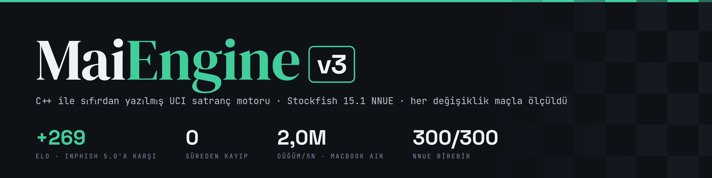
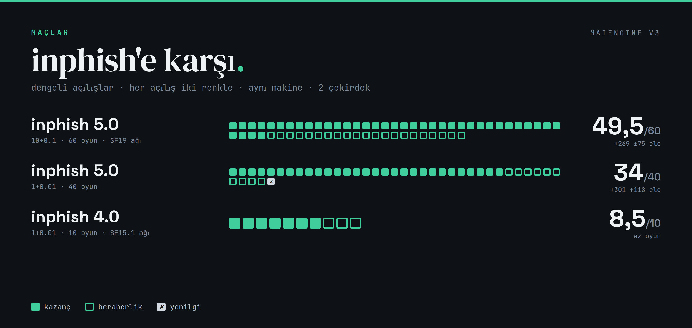
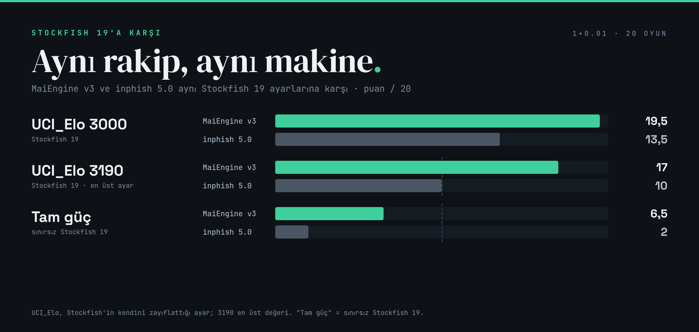
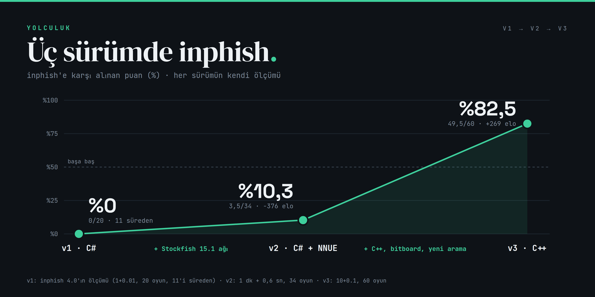
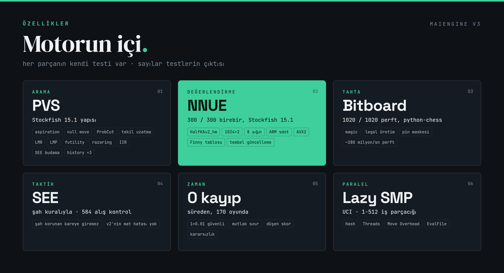
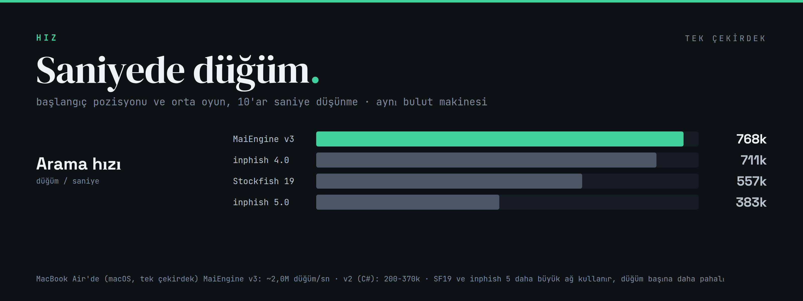

<p align="center">
  
</p>

# MaiEngine v3

C++20 ile sıfırdan yazılan UCI satranç motoru. MaiEngine v2'nin (C#) devamı; hedef:
**inphish**'i yenmek — ve şu an **inphish 5.0'a karşı +269 elo** (10+0.1, 60 oyun, hiç yenilgi yok).

🎬 **Tanıtım videosu:** [`docs/MaiEngine_v3_tanitim.mp4`](docs/MaiEngine_v3_tanitim.mp4) (64 sn, müzikli)

Lisans: **GPLv3** (bkz. `LICENSE`). Değerlendirme için Stockfish 19 NNUE ağı
kullanılıyor (çıkarım kodu bizim, Stockfish'le birebir aynı sonucu veriyor). Arama,
Stockfish 19'un aramasının (ve geliştirme sürümü `49ea5ded`'e kadarki arama
değişikliklerinin) bizim tahta / hamle üretici / NNUE üzerine uyarlaması; tahta,
hamle üretimi, NNUE çıkarımı, iş parçacıkları ve UCI bizim. Kaynak:
<https://github.com/official-stockfish/Stockfish> (GPLv3).

<p align="center"></p>
<p align="center"></p>
<p align="center"></p>

## Durum

| Adım | Durum |
|---|---|
| 1. Bitboard tahta, legal hamle üretimi (pin maskesi), perft | ✅ |
| 2. NNUE (SF19: HalfKAv2_hm + tehditler + piyon çiftleri), NEON dotprod / AVX2, Finny tablosu | ✅ 300/300 birebir |
| 3. Arama (Stockfish 19 portu + dev `49ea5ded`), correction history'ler, kovalı TT, SEE | ✅ |
| 4. UCI, Lazy SMP, zaman yönetimi | ✅ (Syzygy ⏳) |
| 5. Maç testleri (openings2.epd, `tools/match.py`) | ✅ başladı |

## Ağ dosyası

`nn-1a298aa575a0.nnue` (Stockfish 19'un ağı, 98 MB, GPLv3) depoya konmuyor.
Programın yanına ya da çalışma dizinine koy; UCI'de `EvalFile` ile de verilebilir.
İndirme: <https://tests.stockfishchess.org/api/nn/nn-1a298aa575a0.nnue> (SHA-256'nın ilk
12 hanesi dosya adıyla aynı olmalı: `shasum -a 256 nn-1a298aa575a0.nnue`).
v3'ün ilk sürümü Stockfish 15.1 ağını (`nn-ad9b42354671.nnue`) kullanıyordu; o sürüm
`main` geçmişinde duruyor.

Stockfish'in geliştirme sürümündeki SFNNv17 ağı (`nn-252f33942263.nnue`, psqt çıkışı
yok, kendi değerlendirme formülüyle) da destekleniyor: `setoption name EvalFile value
nn-252f33942263.nnue`. Biçim yüklenirken kendiliğinden anlaşılıyor; SF `49ea5ded`'e karşı
300/300 birebir (`tools/ref/sfdev-252f-nnue-ref.txt`). Varsayılan değil: bizde ölçülebilir
bir fark çıkmadı (bkz. Negatif sonuçlar).

## Derleme

```sh
make            # optimize (-O3, -march/-mcpu=native, LTO)
make debug      # assert + AddressSanitizer + UBSan -> maiengine-debug
make test       # perft takımı + python-chess'e karşı 1020 pozisyon + tutarlılık
```

## Komutlar

```
maiengine perft <d> [fen]        toplam düğüm
maiengine divide <d> [fen]       kök hamle başına düğüm (Stockfish "go perft" biçimi)
maiengine suite [full]           bilinen perft sayıları
maiengine epd <dosya> [maxD]     EPD perft takımı ("FEN ;D1 n ;D2 n ...")
maiengine verify <d> [fen]       her düğümde: bitboard/board tutarlılığı, Zobrist,
                                 piyon anahtarı, checkers, CAPTURES+QUIETS=LEGAL,
                                 FEN gidiş-dönüş, undo, null move
maiengine verifyepd <dosya> [d]  EPD'deki her pozisyonda verify
maiengine perftbench             perft hızı
maiengine bench [d] [thr] [MB]   arama bench'i (22 pozisyon, sabit derinlik; düğüm sayısı = imza)
maiengine nnuecheck <ref>        NNUE'yi Stockfish referansıyla karşılaştır + artımlı = sıfırdan kontrolü
maiengine nnuebench              NNUE hızı
maiengine seecheck [epd]         SEE'yi kaba kuvvet alış dizisiyle karşılaştır
maiengine                        (argümansız) UCI modu
```

UCI seçenekleri: `Hash` (64), `Threads` (1), `Move Overhead` (10 ms), `Clear Hash`, `EvalFile`.

<p align="center"></p>

## Tasarım (adım 1)

- **Tahta:** `board[64]` + tip/renk bitboard'ları, `StateInfo` yığını (anahtar,
  piyon anahtarı, rok hakları, en passant, 50 hamle, alınan taş, şah çekenler).
- **Saldırılar:** fancy magic bitboard; magic sayıları açılışta sabit tohumla
  aranır (birkaç ms).
- **Hamle kodu:** 16 bit, Stockfish ile aynı yerleşim (hedef, kaynak, terfi, tip).
- **Legal üretim:** önce "oyna-kontrol et" yok, yasallık maskelerle sağlanıyor:
  - `danger`: rakibin saldırdığı kareler, bizim şah tahtadan kaldırılmış olarak
    (şah, kalenin hattında geri kaçabilir sanılmasın diye)
  - `checkmask`: tek şahta şah çeken taş + aradaki kareler; çifte şahta sadece şah oynar
  - `pinHV` / `pinD`: açmazdaki taşlar sadece kendi hattında gidebilir
  - en passant tahtada denenir (yatay açmaz tuzağı: `K..Pp..r`)
  - rok: geçilen kareler `danger`'a bakılır
- **Üretim tipleri:** `CAPTURES` (tüm alışlar + vezire itiş-terfi), `QUIETS`
  (geri kalan), `LEGAL` (hepsi). `verify` ikisinin birleşiminin tam olarak
  `LEGAL` olduğunu kontrol eder — arama bunlara güvenecek.
- **En passant karesi** sadece gerçekten alabilecek rakip piyon varsa anahtara
  girer (aynı pozisyon = aynı anahtar, TT için önemli).

## Tasarım (adım 2-4)

- **NNUE (Stockfish 19 ağı):** üç girdi seti aynı 1024'lük toplama eklenir:
  HalfKAv2_hm (şah kovası x taş x kare, int16), **FullThreats** (hangi taş hangi
  taşa saldırıyor, int8, 59.808 özellik) ve **PP_3Wide** (aynı/komşu dikeydeki
  piyon çiftleri, int8). Sonra 1024x2 → 32 → 32 → 1, her katmanın kare alınmış ve
  düz kırpılmış çıkışları birlikte ilerler; 8 katman yığını, PSQT dalı. Dosya
  formatı LEB128 sıkıştırmalı. İlk katman seyrek (sadece sıfır olmayan girdiler),
  iç çarpımlar ARM `sdot` / AVX2 `vpmaddubsw`.
- **Tehdit farkları `do_move`'da:** bir taş eklenip çıkınca tehdit kümesi tam olarak
  (a) onun saldırdıkları, (b) ona saldıranlar, (c) o kareden geçen kaydıran ışınları
  kadar değişir; her hamle bu değişiklikleri yazar. `verify` her hamlede "önceki
  tehditler + fark = sonraki tehditler" kontrol eder.
- **Accumulator (Stockfish 19 düzeni):** iş parçacığına ait yığında, her kayıt
  pozisyonun Zobrist anahtarıyla etiketli (tembel güncelleme). HalfKA ve tehditler
  **tek dizide**: bir güncelleme tek geçişte okunup yazılır (int16 ve int8 satırlar aynı
  NEON/AVX2 döngüsünde, toplamın 128'lik dilimi yazmaçlarda). En yakın hesaplı atadan
  ileri her hamle tek tek hesaplanıp saklanır. Şah oynadıysa: son hamleyse ve tahtanın
  aynı yarısındaysa **hybrid** güncelleme (yeni şahın Finny kaydı + önceki toplam − eski
  şahın Finny kaydı + tehdit farkı, tehditler sıfırdan toplanmaz); değilse şimdiki
  pozisyon Finny + tüm tehditlerle tazelenir ve aradaki durumlar **geriye doğru**
  doldurulur. İlk katmanda sıfır olmayan girdiler NEON ile 8'erli bulunuyor.
- **Değerlendirme formülü (SF19):** ağın iki parçası (psqt / katmanlar) ayrışınca
  "karmaşıklık" değeri biraz kısar ve kök skorundan gelen **iyimserliği** büyütür;
  materyalle ölçekleme, 50 hamle sönümü. SFNNv17 ağında SF dev'in formülü: ağ ile
  kaba materyal aynı yönü gösteriyorsa pozisyon "kolay" sayılır. UCI'deki cp, SF19'un
  kazanma oranı modeliyle.
- **Arama (Stockfish 19 + dev `49ea5ded`):** statik değerlendirme **correction
  history**'lerle düzeltilir (piyon, hafif taş, iki renk için piyon olmayan taş
  anahtarları ve 2/4/6 ply önceki hamlelere göre). Budama ve indirgemeler SF19'daki
  gibi: TT kesmesi (TT hamlesinden sonraki kaydı da kontrol ederek), razoring, reverse
  futility, null move (+doğrulama, aynı ply'daki önceki başarılara göre gevşeyen),
  ProbCut, IIR, tekil / çift / üçlü / çoklu-kesme / negatif uzatma, 1/1024 ölçekli LMR,
  futility, SEE ve history budaması; qsearch'te futility ve SEE. Hamle sıralama: TT →
  iyi alışlar → iyi sessizler (butterfly, low-ply, pawn ve 1-6 ply continuation
  history, şah çekme, tehditten kaçma) → kötü alışlar → kötü sessizler. Aspiration
  penceresi kök skorlarının ortalama karesine göre, iyimserlik kök ortalamasından.
  Yaklaşan tekrar Stockfish'teki gibi cuckoo tablolarıyla.
- **SEE şah kuralı:** şah korunan kareye "alamaz" → v2'deki mat kaçırma hatası
  baştan yok. `seecheck` 584 alışta (83'ü şahla) kaba kuvvetle karşılaştırıyor;
  tek fark sınıfı "alış aynı anda açarak şah çekiyor" (Stockfish'te de öyle).
- **TT:** 32 baytlık kovada 3 kayıt, yaş, PV biti; SF19'un yazma kuralları
  (eski aramadan kalan kayıt ezilir, işe yaramayan kaydın derinliği düşürülür).
- **Zaman:** SF19'un optimum/maksimum hesabı + düşen skor / kararsızlık / en iyi
  hamlenin düğüm payı çarpanları, saatte gerideyken daha az süre, ve **mutlak sınır**
  (kalan süre − overhead): 1+0.01'de bile süreden kayıp yok.
- **Lazy SMP:** paylaşılan TT, oylamayla en iyi iş parçacığı.

## Oyun analizi

chess.com'daki "Oyun İncelemesi" gibi: PGN'deki her hamleyi MaiEngine ile değerlendirip
**Parlak, Harika, En İyi, Mükemmel, İyi, Kitap, Yanlışlık, Hata, Kaçırma, Büyük Hata**
olarak sınıflandırır, doğruluk yüzdesi verir ve interaktif bir rapor üretir (tahta, animasyon,
ses, değerlendirme çubuğu ve grafiği, en iyi hamleyi gösterme).

```sh
python3 -m venv tools/.venv && tools/.venv/bin/pip install chess   # bir kez
tools/.venv/bin/python tools/site.py              # site: http://localhost:8080
tools/.venv/bin/python tools/analiz.py oyun.pgn   # komut satırı: oyun.analiz.html
```

- **Sınıflar:** kazanma olasılığı kaybı (Lichess eğrisi, Elo'ya göre yumuşatma yok) —
  %2 / %5 / %10 / %20 sınırları. Harika = tek iyi hamle (ikinci en iyi ≥%20 kötü),
  Parlak = en iyi hamleyle gelen gerçek taş kurbanı.
- **Kitap:** proje kökünde Polyglot `book.bin` varsa açılış hamleleri Kitap sayılır
  (motor gözünde kötü kitap hamleleri — tuzak hatları — yine hata olur).
- Kısayollar: ←/→ hamleler, **B** en iyi hamle, **F** tahtayı çevir, **M** ses.

## Maçlar

`tools/match.py`: gerçek saat (süre+artış), paralel oyun, süreden kayıp tespiti,
PGN kaydı, elo ±%95. Açılışlar `tools/openings2.epd` (200 dengeli açılış, her biri
iki renkle). inphish GitHub kaynağından derlendi (bench imzaları README'leriyle aynı:
5.0 = 74474, 4.0 = 66999). Bulut makinesi: 2 çekirdek, 2 oyun paralel, Hash 64.

| Rakip | Süre | Oyun | Sonuç (MaiV3) | Elo | Süreden kayıp (biz/onlar) |
|---|---|---|---|---|---|
| inphish 4.0.0 | 1+0.01 | 10 | +7 =3 −0 | (az oyun) | 0 / 0 |
| inphish 5.0.0 (SF19 ağı) | 1+0.01 | 40 | +29 =10 −1 | +301 ±118 | 0 / 0 |
| inphish 5.0.0 (SF19 ağı) | 10+0.1 | 60 | +39 =21 −0 | +269 ±75 | 0 / 0 |

### Stockfish 19 aramasına geçiş (bu Mac'te, Apple Silicon, 4 oyun paralel, aynı açılışlar)

| Karşılaştırma | Süre | Oyun | Sonuç | Elo |
|---|---|---|---|---|
| SF19 arama portu, eski aramaya (SF15.1 tarzı, SF19 ağı) karşı | 1+0.01 | 100 | +24 =73 −3 | +74 ±34 |
| + SF dev `49ea5ded` arama değişiklikleri, portun kendisine karşı | 1+0.01 | 400 | +34 =331 −35 | −1 ±14 (nötr) |
| **Son hali** (port + dev değişiklikleri + NNUE hızlanması), eski aramaya karşı | **10+0.1** | **200** | **+19 =180 −1** | **+31 ±15** |

Süreden kayıp hiçbirinde yok. Dengeli açılışlarla beraberlik oranı %80-90; küçük farkları
görmek için çok oyun ya da dengesiz (UHO) açılışlar gerekiyor.

### Stockfish 19'a karşı (inphish'in "UCI_Elo merdiveni" yöntemiyle, aynı makinede)

Stockfish 19 kaynaktan derlendi (`sf_19`, ağ `nn-1a298aa575a0`). 1+0.01, 20 oyun,
renkler değişerek. Karşılaştırma için inphish 5.0 da **aynı makinede aynı maçları** oynadı.

| Rakip | MaiEngine v3 | inphish 5.0 |
|---|---|---|
| SF19 `UCI_Elo 3000` | **19,5/20** (+19 =1 −0) | 13,5/20 (+9 =9 −2) |
| SF19 `UCI_Elo 3190` (en üst ayar) | **17/20** (+14 =6 −0) | 10/20 (+5 =10 −5) |
| SF19 **tam güç** (sınırsız) | **6,5/20** (+0 =13 −7), −127 ±85 | 2/20 (+0 =4 −16), −382 |

Not: `UCI_Elo` ölçeği üstte doyuyor (v2'de de görmüştük: 3000 ve 3190 aynı sonucu
veriyordu); bu yüzden tam güç Stockfish'e karşı sonuç daha anlamlı. inphish kendi
makinesinde SF19 3000'e karşı 16/20, 3190'a karşı 12,5/20 bildirmişti.

## Doğrulama

| Test | Sonuç |
|---|---|
| chessprogramming.org 7 pozisyon, en derin (805M düğüm) | hepsi birebir |
| python-chess'e karşı 1020 pozisyon (20 tuzak + 1000 rastgele), D1–D3 | 0 hata |
| `verifyepd` sanitizer'lı sürümle, aynı 1020 pozisyon, D2 (338 bin düğüm) | 0 hata |
| `verify`: `gives_check` (oynayıp bakarak) ve `legal_move` (liste + çöp hamleler) | 0 hata |
| NNUE, Stockfish 19 referansı (300 pozisyon: psqt, katmanlar ve son değerlendirme ayrı ayrı; ARM) | 300/300 birebir |
| NNUE artımlı = sıfırdan, rastgele ağaçlarda düğüm atlayarak + null move (6,8M düğüm) | 0 hata |
| Tehdit farkları (`verify` / `verifyepd`, her hamlede) | 0 hata |
| Arama, sanitizer'lı sürümle bench | temiz |

## Hız (perft, toplu sayım, tek çekirdek)

| Makine | `bench` |
|---|---|
| Bulut VM (Xeon 2.1 GHz) | ~210 Mnps |
| MacBook Air, Linux VM (aarch64, g++ 11) | ~278 Mnps |

## Hız (arama)

<p align="center"></p>

`tools/speed.py`: tek iş parçacığı, Hash 64, başlangıç + bir orta oyun pozisyonu, 10'ar sn,
aynı bulut makinesi: MaiEngine v3 768k · inphish 4.0 711k · Stockfish 19 557k · inphish 5.0 383k
düğüm/sn. (SF19 ve inphish 5 daha büyük bir ağ kullanıyor, düğüm başına daha pahalı.)

`bench 13` (22 pozisyon, sabit derinlik; imza **606127** düğüm), MacBook Air, macOS: **~1,48M nps**.
SF19 ağına geçiş düğüm başına maliyeti artırmıştı (SF15.1 ağıyla ~2,0M); birleşik
accumulator, hybrid şah güncellemesi, NEON'lu seyrek girdi tespiti, hamleden önce TT
kaydını önbelleğe isteme ve alışlarda / ışın boyunca hareketlerde gereksiz tehdit
satırlarını yazmama (Stockfish'teki `swap_piece` / `noRaysContaining`) farkı kapattı:
aynı pozisyonlarda (`go nodes 4000000`) Stockfish 19'un ~0,85-0,95'i (başlangıç 1,21M'e
karşı 1,41M, orta oyun 1,09M'e karşı 1,31M, oyun sonu 2,30M'e karşı 2,43M); önceki sürüm
~0,6'sıydı.

(v2, C#: 200-370k nps.)

## Görseller ve video

`tools/video/`: `graphics.html` + `data.json` → `node graphics.js` README görsellerini,
`video.html` → `node render.js` (Playwright ile kare kare) + `music.py` (telifsiz,
numpy ile sentez) + ffmpeg tanıtım videosunu üretir. Her sayı `maclar/` altındaki
maç kayıtlarından geliyor. Kurulum: `cd tools/video && npm install`.

## Negatif sonuçlar

_(Denenen ama kazanç getirmeyen değişiklikler buraya yazılır.)_

- **SFNNv17 ağı (`nn-252f33942263`)**, SF19 aramasıyla, SF19 ağına karşı: 1+0.01, 400 oyun,
  +23 =345 −32, **−8 ±13**. Varsayılan yapılmadı (inphish de 7.0'da ölçülebilir fark bulmadı).
- **SF dev `49ea5ded` arama değişiklikleri:** −1 ±14 (400 oyun). Stockfish'in kendi
  testlerinde birkaç elo'luk kazançlar, bu örnekte görünmüyor; zarar da yok, kaldı.
- **Tehdit satırlarını önceden önbelleğe istemek** (`apply_delta`'da bir sonraki dilim): hız farkı yok.
